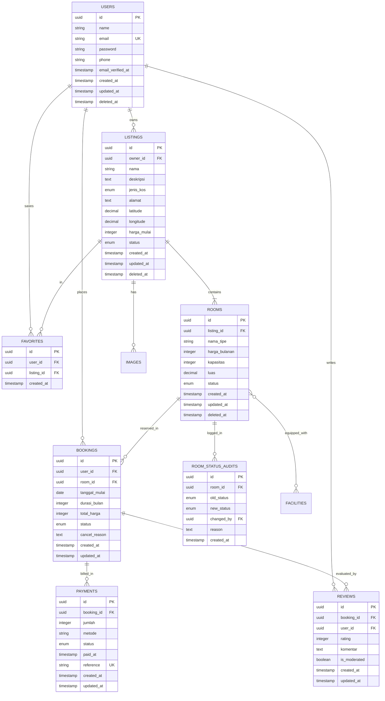

# 🗄️ Database Architecture & Schema Specification — UNNESKost v3

Dokumen ini mendefinisikan skema basis data **PostgreSQL 16**, aturan integritas relasional, strategi indexing, dan *database constraints* untuk **UNNESKost v3**.

---

## 1. Prinsip Utama Desain Basis Data

1. **UUID Primary Keys:** Semua tabel utama menggunakan UUID v7 / v4 sebagai primary key untuk keamanan ID publik dan kemudahan partisi/distribusi.
2. **Nilai Moneter Integer:** Mata uang (Rupiah) selalu disimpan dalam integer terkecil (satuan Rupiah bulat). Dilarang float/double.
3. **Database Invariants:** Integritas transaksi dilindungi oleh *Foreign Key Constraints*, *Check Constraints*, dan *Exclusion Constraints* (PostgreSQL `btree_gist`).
4. **Soft Deletes:** Data master (`listings`, `rooms`, `users`) menggunakan `deleted_at` untuk mencegah kehilangan riwayat data secara permanen.
5. **Optimasi Indeks:** Indeks dibuat spesifik pada kolom filter rutin (harga, tipe, status, relasi foreign key, geolokasi).

---

## 2. Diagram Hubungan Entitas (ERD)



---

## 3. Skema & Definisi Tabel

### 3.1 `listings`
```sql
CREATE TYPE listing_gender_enum AS ENUM ('putra', 'putri', 'campur');
CREATE TYPE listing_status_enum AS ENUM ('draft', 'published', 'archived');

CREATE TABLE listings (
    id UUID PRIMARY KEY DEFAULT gen_random_uuid(),
    owner_id UUID NOT NULL REFERENCES users(id) ON DELETE CASCADE,
    nama VARCHAR(255) NOT NULL,
    deskripsi TEXT NOT NULL,
    jenis_kos listing_gender_enum NOT NULL,
    alamat TEXT NOT NULL,
    latitude NUMERIC(10, 7) NOT NULL,
    longitude NUMERIC(10, 7) NOT NULL,
    peraturan TEXT NULL,
    harga_mulai BIGINT NOT NULL, -- Integer Rupiah
    status listing_status_enum NOT NULL DEFAULT 'published',
    created_at TIMESTAMP WITH TIME ZONE DEFAULT CURRENT_TIMESTAMP,
    updated_at TIMESTAMP WITH TIME ZONE DEFAULT CURRENT_TIMESTAMP,
    deleted_at TIMESTAMP WITH TIME ZONE NULL
);

CREATE INDEX idx_listings_owner_id ON listings(owner_id);
CREATE INDEX idx_listings_jenis_status ON listings(jenis_kos, status);
CREATE INDEX idx_listings_harga_mulai ON listings(harga_mulai);
CREATE INDEX idx_listings_coordinates ON listings(latitude, longitude);
```

### 3.2 `rooms`
```sql
CREATE TYPE room_status_enum AS ENUM ('available', 'booked', 'occupied', 'maintenance');

CREATE TABLE rooms (
    id UUID PRIMARY KEY DEFAULT gen_random_uuid(),
    listing_id UUID NOT NULL REFERENCES listings(id) ON DELETE CASCADE,
    nama_tipe VARCHAR(100) NOT NULL,
    harga_bulanan BIGINT NOT NULL, -- Integer Rupiah
    kapasitas INT NOT NULL DEFAULT 1,
    luas NUMERIC(5, 2) NOT NULL, -- dalam meter persegi
    status room_status_enum NOT NULL DEFAULT 'available',
    created_at TIMESTAMP WITH TIME ZONE DEFAULT CURRENT_TIMESTAMP,
    updated_at TIMESTAMP WITH TIME ZONE DEFAULT CURRENT_TIMESTAMP,
    deleted_at TIMESTAMP WITH TIME ZONE NULL
);

CREATE INDEX idx_rooms_listing_id ON rooms(listing_id);
CREATE INDEX idx_rooms_status ON rooms(status);
CREATE INDEX idx_rooms_harga ON rooms(harga_bulanan);
```

### 3.3 `bookings` & Double-Booking Protection
```sql
CREATE TYPE booking_status_enum AS ENUM ('pending', 'confirmed', 'active', 'completed', 'cancelled');

CREATE TABLE bookings (
    id UUID PRIMARY KEY DEFAULT gen_random_uuid(),
    user_id UUID NOT NULL REFERENCES users(id) ON DELETE RESTRICT,
    room_id UUID NOT NULL REFERENCES rooms(id) ON DELETE RESTRICT,
    tanggal_mulai DATE NOT NULL,
    durasi_bulan INT NOT NULL,
    total_harga BIGINT NOT NULL,
    status booking_status_enum NOT NULL DEFAULT 'pending',
    cancel_reason TEXT NULL,
    created_at TIMESTAMP WITH TIME ZONE DEFAULT CURRENT_TIMESTAMP,
    updated_at TIMESTAMP WITH TIME ZONE DEFAULT CURRENT_TIMESTAMP
);

CREATE INDEX idx_bookings_user_id ON bookings(user_id);
CREATE INDEX idx_bookings_room_status ON bookings(room_id, status);
```

> **Mitigasi Double Booking:**
> Pada level query aplikasi, sistem menggunakan `DB::transaction()` dengan `Room::where('id', $id)->lockForUpdate()->first()`. Di level PostgreSQL, dapat diaktifkan ekstensi `btree_gist` untuk memberlakukan `EXCLUDE USING gist (room_id WITH =, daterange(tanggal_mulai, tanggal_mulai + (durasi_bulan * INTERVAL '1 month')::interval) WITH &&)` pada booking aktif.

---

### 3.4 `room_status_audits`
```sql
CREATE TABLE room_status_audits (
    id UUID PRIMARY KEY DEFAULT gen_random_uuid(),
    room_id UUID NOT NULL REFERENCES rooms(id) ON DELETE CASCADE,
    old_status room_status_enum NOT NULL,
    new_status room_status_enum NOT NULL,
    changed_by UUID NOT NULL REFERENCES users(id) ON DELETE RESTRICT,
    reason TEXT NULL,
    created_at TIMESTAMP WITH TIME ZONE DEFAULT CURRENT_TIMESTAMP
);

CREATE INDEX idx_room_audits_room_id ON room_status_audits(room_id);
```

---

### 3.5 `favorites` & `reviews`
```sql
CREATE TABLE favorites (
    id UUID PRIMARY KEY DEFAULT gen_random_uuid(),
    user_id UUID NOT NULL REFERENCES users(id) ON DELETE CASCADE,
    listing_id UUID NOT NULL REFERENCES listings(id) ON DELETE CASCADE,
    created_at TIMESTAMP WITH TIME ZONE DEFAULT CURRENT_TIMESTAMP,
    CONSTRAINT unique_user_listing_favorite UNIQUE(user_id, listing_id)
);

CREATE TABLE reviews (
    id UUID PRIMARY KEY DEFAULT gen_random_uuid(),
    booking_id UUID NOT NULL UNIQUE REFERENCES bookings(id) ON DELETE CASCADE,
    user_id UUID NOT NULL REFERENCES users(id) ON DELETE CASCADE,
    rating SMALLINT NOT NULL CHECK (rating >= 1 AND rating <= 5),
    komentar TEXT NOT NULL,
    is_moderated BOOLEAN NOT NULL DEFAULT FALSE,
    created_at TIMESTAMP WITH TIME ZONE DEFAULT CURRENT_TIMESTAMP,
    updated_at TIMESTAMP WITH TIME ZONE DEFAULT CURRENT_TIMESTAMP
);
```
