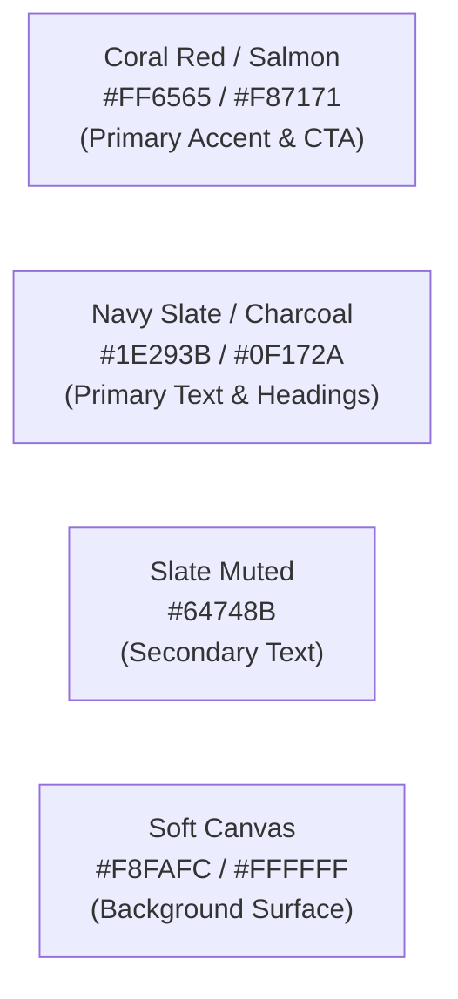

# 🎨 Panduan Identitas Visual & Brand — Pusat Kost UNNES

> Panduan penggunaan logo resmi, palet warna, dan tipografi untuk antarmuka pengguna (**UI Design System**) pada platform **Pusat Kost UNNES (UNNESKost v3)**.

---

## 1. Varian Logo Resmi

Platform memiliki 2 varian lockup logo resmi:

```
File Paths:
1. Horizontal Lockup (Desktop Navbar, Header, Invoice, Email):
   - public/images/logo-horizontal.png
   - docs/assets/logo-horizontal.png

2. Square / Stacked Lockup (Favicon, App Icon, Profile Avatar, Mobile Card):
   - public/images/logo.jpg
   - docs/assets/logo.jpg
```

### Karakteristik Varian Logo:
- **Varian Horizontal (`logo-horizontal.png`):** Simbol rumah di sebelah kiri dengan tipografi `"pusat kost"` dan `"U N N E S"` di sebelah kanan. Sangat ideal untuk Navbar atas, Header dashboard, dan kop surat digital/invoice.
- **Varian Square / Stacked (`logo.jpg`):** Simbol rumah di atas dan tipografi di bawah. Digunakan untuk favicon browser, splash screen, kartu identitas, dan media sosial.

---

## 2. Palet Warna Resmi (Brand Color Palette)



| Nama Warna | Hex Code | Tailwind CSS Class | Penggunaan |
|---|---|---|---|
| **Brand Primary (Coral/Salmon)** | `#FF6565` / `#FA5252` | `bg-rose-500` / `text-rose-500` | Logo, tombol utama CTA (*Booking*, *Bayar*), badge penting, link hover. |
| **Brand Secondary (Navy Slate)** | `#1E293B` | `text-slate-900` / `bg-slate-900` | Judul teks (*headings*), teks brand, navbar aktif, tombol sekunder. |
| **Muted Slate (Abu-abu)** | `#64748B` | `text-slate-500` | Teks pendukung, deskripsi, informasi fasilitas, border tipis. |
| **Success Emerald** | `#10B981` | `text-emerald-600` / `bg-emerald-50` | Status kamar `AVAILABLE`, notifikasi pembayaran berhasil. |
| **Warning Amber** | `#F59E0B` | `text-amber-600` / `bg-amber-50` | Status booking `PENDING`, menunggu moderasi ulasan. |
| **Danger Red** | `#EF4444` | `text-red-600` / `bg-red-50` | Status booking `CANCELLED`, kamar `MAINTENANCE`, tombol hapus. |
| **Canvas Background** | `#F8FAFC` | `bg-slate-50` | Latar belakang halaman aplikasi. |

---

## 3. Tipografi (Typography)

- **Font Keluarga Utama:** `Plus Jakarta Sans` / `Inter` (Sans-serif modern, clean, dan mudah dibaca di mobile).
- **Font Display / Brand:** `Plus Jakarta Sans` (dengan varian *weight* `600` - SemiBold dan `700` - Bold untuk judul dan nama kos).

---

## 4. Komponen Logo di Frontend React (`Logo.tsx`)

Komponen reusable untuk menampilkan logo di Navbar (horizontal) atau di Footer/Card (stacked/square):

```tsx
// resources/js/components/shared/Logo.tsx
import { Link } from '@inertiajs/react';

interface LogoProps {
  variant?: 'horizontal' | 'square';
  size?: 'sm' | 'md' | 'lg';
  className?: string;
}

export function Logo({ variant = 'horizontal', size = 'md', className = '' }: LogoProps) {
  const heightClasses = {
    sm: 'h-7',
    md: 'h-9',
    lg: 'h-12',
  };

  const src = variant === 'horizontal' 
    ? '/images/logo-horizontal.png' 
    : '/images/logo.jpg';

  return (
    <Link href="/" className={`inline-flex items-center transition-opacity hover:opacity-90 ${className}`}>
      
    </Link>
  );
}
```
