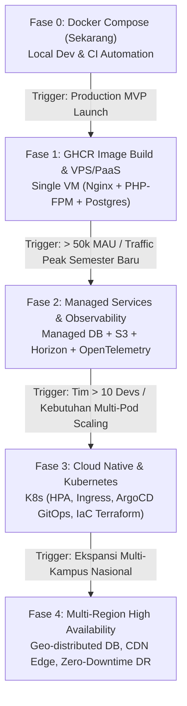

# 🚀 Infrastructure Evolution & Deployment Roadmap — UNNESKost v3

Dokumen ini mendokumentasikan peta jalan evolusi infrastruktur dari lingkungan *Local Development* bertahap menuju arsitektur Cloud skala besar kelas produksi.

> [!NOTE]
> Sesuai prinsip **Simplicity over cleverness** dan **Evolution-ready, not evolution-now**, tahap saat ini fokus pada **Docker Compose lokal & CI/CD otomatis**. Tahap-tahap berikutnya diaktifkan berdasarkan **trigger konkret** (beban traffic, ukuran tim pengembang, atau kebutuhan SLA).

---

## 🗺️ Roadmap Evolusi Bertahap

---

## 1. Rincian Fase Evolusi & Trigger Kriteria

### Fase 0: Local Docker Compose & GitHub Actions (Saat Ini)
- **Komponen:** Docker Compose (Nginx, PHP-FPM 8.4, PostgreSQL 16, Redis 7, Meilisearch, Mailpit).
- **Target Penggunaan:** Pengembangan lokal dan pengujian otomatis di GitHub Actions (Pest, PHPStan, Lint, Vitest).
- **Trigger Naik ke Fase 1:** Aplikasi siap dideploy ke server staging/production pertama kali.

---

### Fase 1: Production VPS / PaaS Single Node
- **Arsitektur:**
  - Build container image otomatis via GitHub Actions ke GitHub Container Registry (GHCR) dengan tagging SHA commit & SemVer.
  - Deployment ke single instance VPS (Debian/Ubuntu) menggunakan Docker Compose atau Ansible.
  - Nginx reverse proxy dengan Let's Encrypt SSL/TLS.
  - Queue worker dikelola via Supervisor.
- **Kapasitas:** Mampu menangani hingga 10.000 pengguna aktif bulanan (MAU).
- **Trigger Naik ke Fase 2:** Beban database mulai mempengaruhi latensi web (> 200ms) atau storage disk lokal server mulai penuh karena foto kos.

---

### Fase 2: Managed Cloud Infrastructure & Observability
- **Arsitektur:**
  - Database dipindahkan ke **Managed PostgreSQL** (Supabase / AWS RDS / DigitalOcean Managed DB) dengan automated backup & point-in-time recovery.
  - File upload gambar kos dipindahkan ke **S3 / Cloudflare R2** via CDN (Cloudflare CDN).
  - Queue & Cache dipindahkan ke **Managed Redis**.
  - Monitoring & Logging: Laravel Pulse, Horizon dashboard, dan OpenTelemetry structured logs.
- **Kapasitas:** Mampu menangani lonjakan traffic mahasiswa saat pendaftaran semester baru (50.000 - 100.000 MAU).
- **Trigger Naik ke Fase 3:** Tim pengembang membesar (> 8 engineer), kebutuhan rilis zero-downtime harian, dan butuh auto-scaling horizontal pod.

---

### Fase 3: Cloud-Native Kubernetes (K8s) & GitOps
- **Arsitektur:**
  - Infrastruktur didefinisikan sebagai kode (**Infrastructure as Code / IaC**) menggunakan **Terraform** / OpenTofu.
  - Cluster Kubernetes (EKS / GKE / DOKS):
    - Ingress Nginx / Traefik
    - Horizontal Pod Autoscaler (HPA) untuk web pods dan queue worker pods
    - CronJobs untuk Laravel Scheduler
  - Deploy otomatis via **GitOps (ArgoCD)**.
  - Observability lengkap: Prometheus, Grafana, dan Loki.
- **Trigger Naik ke Fase 4:** Ekspansi platform dari UNNES ke seluruh kampus di Indonesia dengan kebutuhan High Availability 99.99% dan multi-region redundancy.

---

### Fase 4: High Availability (HA) & Disaster Recovery (DR)
- **Arsitektur:**
  - Multi-region database replication dengan read-replicas.
  - Global Server Load Balancing (GSLB) & Edge Computing (Cloudflare Workers).
  - Disaster Recovery Plan (RPO < 5 menit, RTO < 15 menit).
