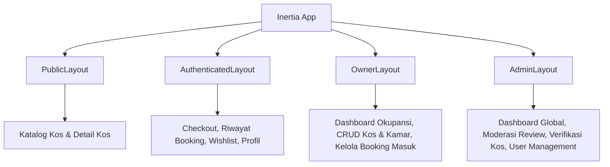

# 🖥️ Frontend Inventory: Pages, Components & Layouts — UNNESKost v3

> Katalog lengkap seluruh halaman (*Pages*), komponen UI, rute antarmuka (*Inertia Routes*), serta panduan *Responsive & State States* pada **Pusat Kost UNNES (UNNESKost v3)**.

---

## 1. Peta Layout Aplikasi (`resources/js/layouts/`)



1. **`PublicLayout.tsx`**:
   - Header/Navbar publik dengan `Logo`, Pencarian Cepat, Tombol Masuk/Daftar, dan Switch Mode.
   - Footer dengan informasi kampus UNNES, tautan bantuan, dan hak cipta.
2. **`AuthenticatedLayout.tsx`**:
   - Navbar mahasiswa dengan menu dropdown profil, riwayat sewa (*My Bookings*), dan wishlist (*Favorites*).
3. **`OwnerLayout.tsx`**:
   - Sidebar navigasi khusus pemilik kos: Dashboard, Kos Saya, Daftar Kamar, Permintaan Booking Masuk, Laporan Pendapatan.
4. **`AdminLayout.tsx`**:
   - Sidebar navigasi administrator: Dashboard Metrik, Verifikasi Kos, Moderasi Ulasan, Manajemen User, Log Sistem.

---

## 2. Inventaris Halaman Berdasarkan Modul Fitur (`resources/js/features/`)

### 2.1 Modul Listings & Discovery (`features/listings/`)
| Komponen Halaman | Rute URL | Deskripsi |
|---|---|---|
| `pages/Index.tsx` | `GET /` & `GET /listings` | **Landing Page & Katalog Pencarian Kos**: Hero section, search bar instan, filter bar (harga, fasilitas, jenis kelamin), grid daftar kos (`ListingCard`), dan pagination. |
| `pages/Show.tsx` | `GET /listings/{slug}` | **Detail Kos & Kamar**: Galeri foto interaktif (`PhotoCollage`), deskripsi & peraturan, fasilitas kos, peta lokasi koordinat UNNES, daftar tipe kamar (`RoomCard`), ulasan tenant, serta `StickyBookingWidget`. |

### 2.2 Modul Booking & Transaksi (`features/booking/`)
| Komponen Halaman | Rute URL | Deskripsi |
|---|---|---|
| `pages/Checkout.tsx` | `GET /bookings/create/{roomId}` | **Formulir Sewa & Reservasi**: Pemilihan tanggal mulai sewa, durasi sewa (1–12 bulan), catatan penyewa, rincian biaya (harga kamar $\times$ durasi), serta tombol konfirmasi. |
| `pages/Show.tsx` | `GET /bookings/{id}` | **Detail & Status Booking**: Informasi kamar, status booking (`PENDING`, `CONFIRMED`, `ACTIVE`), batas waktu pembayaran, instruksi transfer, dan tombol batalkan sewa (`CancelDialog`). |
| `pages/History.tsx` | `GET /my-bookings` | **Riwayat Pemesanan Mahasiswa**: Tab booking aktif, selesai, dan dibatalkan, dengan tombol aksi cepat (bayar, beri ulasan, cetak invoice). |

### 2.3 Modul Wishlist / Favorit (`features/favorites/`)
| Komponen Halaman | Rute URL | Deskripsi |
|---|---|---|
| `pages/Index.tsx` | `GET /favorites` | **Daftar Kos Favorit**: Grid kartu kos yang disimpan oleh mahasiswa dengan tombol toggle cepat dan `EmptyState` jika belum ada kos tersimpan. |

### 2.4 Modul Ulasan & Rating (`features/review/`)
| Komponen Dialog/Halaman | Deskripsi |
|---|---|
| `components/ReviewModal.tsx` | Modal dialog untuk memberi rating 1–5 bintang, memilih kategori kepuasan (kebersihan, keamanan, keramahan pemilik), dan menulis testimoni pasca sewa selesai. |

### 2.5 Modul Owner Dashboard (`features/owner/`)
| Komponen Halaman | Rute URL | Deskripsi |
|---|---|---|
| `pages/Dashboard.tsx` | `GET /owner/dashboard` | Statistik okupansi kamar, jumlah kamar terisi/kosong, total booking bulan ini, estimasi pendapatan sewa. |
| `pages/listings/Index.tsx` | `GET /owner/listings` | Daftar kos milik owner dengan status verifikasi & tombol aksi (Edit, Tambah Kamar). |
| `pages/listings/Create.tsx` / `Edit.tsx` | `GET /owner/listings/create` | Formulir lengkap tambah/edit kos: metadata, koordinat maps, fasilitas, dan multi-image upload. |
| `pages/rooms/Create.tsx` / `Edit.tsx` | `GET /owner/listings/{id}/rooms/create` | Formulir tipe kamar, harga bulanan, ukuran $m^2$, dan fasilitas kamar. |
| `pages/bookings/Index.tsx` | `GET /owner/bookings` | Kelola reservasi masuk dari mahasiswa, tombol setujui/tolak, dan audit status kamar. |

### 2.6 Modul Admin Dashboard (`features/admin/`)
| Komponen Halaman | Rute URL | Deskripsi |
|---|---|---|
| `pages/Dashboard.tsx` | `GET /admin/dashboard` | Metrik platform: total kos terdaftar, total transaksi, pengguna aktif, grafik bulanan. |
| `pages/listings/Index.tsx` | `GET /admin/listings` | Daftar seluruh kos di platform dengan filter status verifikasi (Draft, Published, Archived). |
| `pages/reviews/Index.tsx` | `GET /admin/reviews` | Antrean moderasi ulasan masuk dari tenant (tombol setujui / tolak / sembunyikan). |
| `pages/users/Index.tsx` | `GET /admin/users` | Daftar seluruh user dengan filter role (`admin`, `owner`, `user`) dan reset password. |

---

## 3. Komponen UI Reusable (`components/ui/` & `components/shared/`)

```
resources/js/components/
├── ui/                           # Headless Radix / shadcn style
│   ├── Button.tsx                # Varian: default (coral), outline, ghost, destructive
│   ├── Input.tsx                 # Input text, email, number dengan error label
│   ├── Textarea.tsx              # Input multiline deskripsi & peraturan
│   ├── Select.tsx                # Dropdown pilihan beranimasi
│   ├── Badge.tsx                 # Label status (Tersedia, Penuh, Booking, Putra, Putri)
│   ├── Card.tsx                  # Container card dengan header, content, footer
│   ├── Modal.tsx / Dialog.tsx    # Pop-up modal accessible dengan focus trap
│   ├── Sheet.tsx                 # Bottom sheet drawer untuk filter di mobile
│   ├── Tabs.tsx                  # Navigasi tab konten
│   ├── Skeleton.tsx              # Placeholder loading beranimasi saat fetch
│   └── Toast.tsx                 # Notifikasi melayang global
│
└── shared/                       # Komponen gabungan lintas modul
    ├── Logo.tsx                  # Brand logo Pusat Kost UNNES responsif
    ├── ListingCard.tsx           # Kartu kos: gambar thumbnail, harga, badge jenis, lokasi
    ├── FilterBar.tsx             # Bar pencarian & filter dinamis (Desktop & Mobile)
    ├── RoomBadge.tsx             # Badge status kamar (Available/Booked/Occupied)
    ├── PhotoCollage.tsx          # Tampilan grid 5 foto kos interaktif
    ├── StickyBookingWidget.tsx   # Widget kalkulator sewa sticky di sidebar & bottom mobile
    ├── EmptyState.tsx            # Tampilan ramah saat data kosong
    └── Pagination.tsx            # Navigasi halaman Inertia berhalaman
```

---

## 4. Standar Responsivitas & State UX

### 4.1 Responsive Layout (Mobile-First):
- **Desktop ($\ge 1024\text{px}$):** Grid 3 kolom untuk kartu kos, sidebar filter tetap di kiri, `StickyBookingWidget` mengambang di kanan detail kos.
- **Tablet ($768\text{px} - 1023\text{px}$):** Grid 2 kolom kartu kos.
- **Mobile ($< 768\text{px}$):** Grid 1 kolom kartu kos, tombol filter memunculkan `Sheet` (*Bottom Drawer*), tombol booking menjadi bar lengket (*sticky bottom action bar*) di bagian bawah layar.

### 4.2 State UX yang Wajib Ada di Setiap Komponen:
1. **Loading / Skeleton State:** Menampilkan animasi shimmer skeleton saat halaman/data sedang dimuat.
2. **Empty State:** Menampilkan ilustrasi dan pesan panduan ramah saat hasil pencarian atau data wishlist kosong.
3. **Disabled State:** Tombol tidak dapat diklik saat form sedang dikirim (`isSubmitting: true`) disertai ikon spinner.
4. **Error State:** Teks pesan eror berwarna merah yang jelas di bawah setiap field input yang tidak valid.
