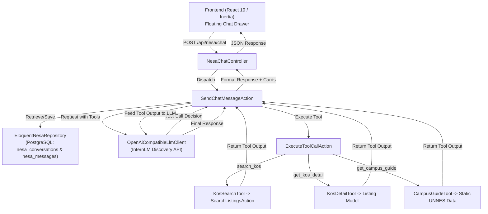

# PRD & Technical Design: NESA (UNNES Smart Assistant) — Resilient Agentic RAG Chatbot

- **Document Version:** 1.0.0
- **Date:** 2026-10-16
- **Status:** Approved for Implementation
- **Target Audience:** AI Engineers, Fullstack Engineers, Technical Reviewers
- **Target Repository:** UNNESKost v3 (Laravel 12 + Inertia.js v3 + React 19 + TypeScript + PostgreSQL 16 + Redis)

---

## 1. Executive Summary & Purpose

**NESA (*UNNES Smart Assistant*)** adalah asisten percakapan cerdas berbasis **Agentic Retrieval-Augmented Generation (RAG)** yang dirancang untuk membantu calon penghuni (mahasiswa UNNES dan masyarakat umum) menemukan hunian kos ideal di sekitar Universitas Negeri Semarang.

Berbeda dari chatbot biasa yang sekadar merangkum teks atau rentan terhadap halusinasi, NESA dilengkapi kemampuan **Tool Calling (Function Calling)** untuk mengeksekusi query database riil (*grounded database retrieval*). Dengan demikian, data harga sewa, ketersediaan kamar, dan aturan kos selalu 100% akurat. 

Sistem ini didesain sebagai showcase portfolio **Senior AI Engineer**, menampilkan:
1. **Provider-Agnostic LLM Client** (kompatibel dengan OpenAI spec, dikonfigurasi untuk InternLM Discovery API `https://discovery-api.intern-ai.org.cn/v1`).
2. **Multi-Turn Agentic Tool Calling Loop** yang mengeksekusi domain logic di Laravel.
3. **Graceful Fallback & Fault Tolerance** yang menjamin layanan tetap berfungsi meskipun penyedia AI pihak ketiga mengalami kendala jaringan atau *rate-limit*.
4. **Interactive Recommendation UI** (percakapan alami yang terhubung langsung dengan kartu listing kos interaktif).
5. **AI Observability & Audit Logging** (pencatatan latensi, penggunaan token, dan eksekusi tool di PostgreSQL).

---

## 2. System Architecture & Domain Boundaries

Sesuai aturan arsitektur **Modular Monolith** di `AGENTS.md`, seluruh subsistem AI diisolasi dalam bounded context `app/Domain/Ai/`.



---

## 3. Database Schema (PostgreSQL)

### 3.1. Tabel `nesa_conversations`
Menyimpan sesi percakapan untuk pengguna terdaftar maupun tamu (*guest*).

| Kolom | Tipe Data | Keterangan |
| :--- | :--- | :--- |
| `id` | `UUID` | Primary Key |
| `user_id` | `BIGINT NULLABLE` | Relasi ke `users.id` (onDelete: cascade). `NULL` jika tamu belum login. |
| `session_token` | `VARCHAR(100)` | Token unik identifikasi sesi di browser (disimpan di `localStorage`). |
| `title` | `VARCHAR(255)` | Judul percakapan otomatis dibuat dari pesan awal pengguna. |
| `created_at` | `TIMESTAMP` | Waktu dibuat |
| `updated_at` | `TIMESTAMP` | Waktu interaksi terakhir |

Index: `['session_token']`, `['user_id']`.

### 3.2. Tabel `nesa_messages`
Menyimpan setiap giliran pesan (*turn-based messages*) beserta riwayat pemanggilan tool dan metrik AI.

| Kolom | Tipe Data | Keterangan |
| :--- | :--- | :--- |
| `id` | `UUID` | Primary Key |
| `conversation_id` | `UUID` | Foreign Key ke `nesa_conversations.id` (onDelete: cascade). |
| `role` | `VARCHAR(20)` | `user`, `assistant`, `tool`, `system`. |
| `content` | `TEXT` | Teks pesan percakapan. |
| `tool_calls` | `JSONB NULLABLE` | Array fungsi yang dipanggil oleh model. |
| `tool_call_id` | `VARCHAR(100) NULLABLE` | ID korelasi saat role bernilai `tool`. |
| `recommended_listing_ids` | `JSONB NULLABLE` | Array UUID listing kos untuk dirender sebagai *interactive cards*. |
| `tokens_used` | `INTEGER NULLABLE` | Jumlah token yang digunakan pada turn ini. |
| `latency_ms` | `INTEGER NULLABLE` | Durasi inferensi LLM dalam milidetik (observabilitas). |
| `created_at` | `TIMESTAMP` | Waktu pesan dibuat |

Index: `['conversation_id', 'created_at']`.

---

## 4. LLM Client & Provider Configuration

### 4.1. Provider-Agnostic Adapter (`OpenAiCompatibleLlmClient`)
Mengimplementasikan interface `LlmClientInterface` dengan protokol OpenAI REST:
- **Base URL:** Diambil dari `.env` (`AI_BASE_URL`).
- **Endpoint:** `POST {AI_BASE_URL}/chat/completions`
- **Header:** `Authorization: Bearer {AI_API_KEY}`, `Content-Type: application/json`
- **Timeout:** 15 detik (dengan fallback otomatis jika terjadi kegagalan).

### 4.2. File `.env` & `config/ai.php`
```env
AI_BASE_URL=https://discovery-api.intern-ai.org.cn/v1
AI_API_KEY=your_intern_ai_token_here
AI_MODEL=intern-latest
AI_MAX_TOKENS=1024
AI_TEMPERATURE=0.7
AI_TIMEOUT_SECONDS=15
```

---

## 5. Agentic Tools Definition & Domain Integration

NESA dibekali 3 tools utama yang dideklarasikan kepada LLM:

### 5.1. Tool 1: `search_kos`
- **Deskripsi:** Mencari kos di lingkar kampus UNNES berdasarkan kriteria pengguna.
- **Argumen:**
  - `gender` (string optional): `putra`, `putri`, `campur`.
  - `area` (string optional): `Sekaran`, `Banaran`, `Taman Siswa`, `Patemon`, `Gunungpati`, `Menoreh`, `Kalisegoro`, `Trangkil`.
  - `max_price` (integer optional): Batas harga sewa maksimal/bulan.
  - `min_price` (integer optional): Batas harga sewa minimal/bulan.
  - `facilities` (array string optional): Daftar fasilitas penting (misal: AC, KM Dalam, WiFi, Parkir Mobil).
- **Backend Handler:** Memanggil `App\Domain\Search\Actions\SearchListingsAction` yang sudah teruji dan bebas N+1 query.

### 5.2. Tool 2: `get_kos_detail`
- **Deskripsi:** Mengambil detail lengkap kos berdasarkan slug atau nama kos.
- **Argumen:** `slug` (string required).
- **Backend Handler:** Mengambil data kamar aktif, harga deposit, aturan jam malam, dan foto galeri kos.

### 5.3. Tool 3: `get_campus_guide`
- **Deskripsi:** Memberikan info gerbang kampus UNNES dan fakultas terdekat.
- **Argumen:** `faculty` (string required): `FBS`, `FT`, `FMIPA`, `FEB`, `FIP`, `FIK`, `FIS`, `FK`, `Farmasi`.
- **Backend Handler:** Menyajikan panduan zona kampus UNNES (misal: FBS/Rektorat paling dekat ke Sekaran, FT/FMIPA ke Banaran, FIP ke Patemon, FIK ke Gunungpati).

---

## 6. Fault Tolerance & Graceful Fallback (Approach C)

Untuk memastikan sistem tidak pernah mogok (*resilient*):
1. **API Timeout / Connection Error:** Jika panggilan ke InternLM gagal atau melebihi timeout, backend mendeteksi kata kunci dari pesan pengguna (misal: "putri", "sekaran", "wifi") lalu menjalankan `SearchListingsAction` lokal.
2. **Fallback Response:** NESA merespons dengan pesan ramah:
   > *"Saat ini koneksi analitik saya sedang sibuk, namun berikut adalah beberapa rekomendasi kos di UNNES yang cocok dengan pencarian Anda:"*
   disertai daftar kartu kos interaktif.
3. **Loop Breaker:** Siklus tool-calling dibatasi maksimal 3 putaran (*max turns = 3*) untuk mencegah *infinite loop* atau pembengkakan token.

---

## 7. Frontend Architecture & UI Design (Taste Compliant)

Komponen UI NESA dirancang sesuai prinsip **Taste Skill** (elegan, non-slop, fungsional, dan responsif):

1. **`NesaWidgetButton.tsx` (Trigger Floating):**
   - Mengambang di kanan bawah layar (`fixed bottom-6 right-6 z-40`).
   - Avatar NESA dengan cincin aksen hijau *emerald* dan status online.
   - Badge notifikasi sapaan ramah pada kunjungan pertama.
2. **`NesaChatDrawer.tsx` (Panel Obrolan):**
   - Modal geser (*slide-over*) pada mobile dan dialog mengambang (*popover card*) pada desktop (lebar 420px, tinggi 600px).
   - **Quick Action Chips:** Pintasan pertanyaan populer mahasiswa (misal: *"Kos putri dekat FBS"*, *"Kos dekat FT free listrik"*, *"Kos campur ada parkir mobil"*).
   - **Message Bubble:** Tipografi nyaman dibaca, pemisahan jelas antara pesan pengguna dan respon NESA.
   - **Interactive Listing Card:** Kartu ringkas dengan gambar utama, judul, area, tag gender, harga per bulan, dan tombol *"Lihat Detail Kos"* yang langsung mengarahkan ke halaman kos.
   - **Reset / Clear Session:** Tombol untuk membersihkan sesi dan memulai obrolan baru.

---

## 8. Verification & Testing Strategy

1. **Unit Testing:**
   - `OpenAiCompatibleLlmClientTest`: Uji request payload, token parsing, dan penanganan status HTTP non-200.
   - `KosSearchToolTest`: Uji konversi argumen JSON ke DTO `SearchCriteria`.
2. **Feature Testing (Pest PHP):**
   - `NesaChatFlowTest`: Uji alur pesan user, pembentukan session token, penyimpanan riwayat ke database, dan response JSON.
   - `NesaToolExecutionTest`: Uji saat model mengembalikan tool call, Action mengeksekusi data riil dan menyertakan `recommended_listing_ids`.
   - `NesaFallbackTest`: Uji saat LLM client throw exception / timeout, sistem tetap memberikan response HTTP 200 dengan data kos fallback.
3. **Static Analysis & Standards:**
   - PHPStan Level Max: 0 errors pada seluruh berkas di `app/Domain/Ai/`.
   - Laravel Pint: Lolos format PSR-12 tanpa warning.
   - TypeScript Strict: 0 error pada komponen frontend NESA.

---

## 9. Definition of Done (DoD)

- [ ] Migrasi database `nesa_conversations` dan `nesa_messages` berhasil dieksekusi.
- [ ] Bounded context `app/Domain/Ai/` selesai dengan unit test & feature test hijau.
- [ ] Endpoint `POST /api/nesa/chat` dan `GET /api/nesa/history` berfungsi dengan baik.
- [ ] Floating widget NESA terpasang di layout utama publik (`PublicLayout.tsx`).
- [ ] Rekomendasi kos tampil dalam bentuk kartu interaktif yang dapat diklik.
- [ ] Pengujian fallback berfungsi saat API key kosong atau API offline.
- [ ] PHPStan Level Max dan Pint bersih.
