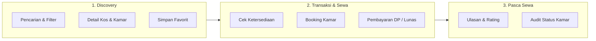

# 📋 UNNESKost v3 — System Requirements Specification (SRS)

> Dokumen spesifikasi kebutuhan fungsional, non-fungsional, aturan bisnis, dan batasan domain untuk platform **UNNESKost v3**.

---

## 1. Ringkasan Produk

**UNNESKost** adalah platform marketplace digital dan sistem manajemen persewaan kos terpadu yang dirancang khusus untuk civitas akademika dan mahasiswa Universitas Negeri Semarang (UNNES) serta pemilik kos (*owner*).

### 🎯 Tujuan Utama:
1. Memberikan kemudahan bagi mahasiswa dalam mencari, membandingkan, dan memesan kamar kos di sekitar kampus UNNES (Sekaran, Ngaliyan, Kelud, dsb).
2. Memfasilitasi pemilik kos dalam mengelola ketersediaan kamar, reservasi, pembayaran, dan pencatatan riwayat hunian secara transparan.
3. Menjamin keandalan transaksi tanpa risiko *double-booking* menggunakan integritas data tingkat database (*DB locking* & *exclusion constraints*).

---

## 2. Peran Pengguna & Hak Akses (User Roles & RBAC)

| Peran (*Role*) | Deskripsi | Hak Akses Utama |
|---|---|---|
| **Admin** | Administrator platform & moderator konten | Mengelola seluruh data kos, memoderasi ulasan (*review*), memverifikasi akun owner, mengelola hak akses pengguna, memantau metrik operasional sistem. |
| **Owner** | Pemilik properti kos / juragan kos | Membuat dan mengedit profil kos miliknya, menambah/mengubah tipe dan status kamar, melihat daftar pesanan (*booking*) masuk, mengonfirmasi/menolak sewa, melihat riwayat audit status kamar. |
| **Tenant / User** | Mahasiswa / calon penyewa kos | Menjelajah kos via pencarian & filter, menyimpan kos ke favorit (*wishlist*), melakukan reservasi/booking kamar, mengunggah bukti pembayaran, memberi ulasan setelah masa sewa selesai. |

---

## 3. Kebutuhan Fungsional (Functional Requirements)

### 3.1 Modul Listing Properti Kos
- **FR-LIST-01 (Data Kos):** Menyimpan nama kos, deskripsi lengkap, jenis kos (Putra, Putri, Campur), alamat lengkap, titik koordinat geografis (Latitude & Longitude), peraturan kos, dan harga termurah (*starting price*).
- **FR-LIST-02 (Fasilitas Kos):** Manajemen fasilitas umum kos (Wi-Fi, Parkir Mobil/Motor, Dapur Bersama, CCTV, Penjaga Kos, dsb) dengan relasi ikon dan nama fasilitas.
- **FR-LIST-03 (Galeri Gambar):** Upload banyak foto kos (*morph relation*) dengan urutan tampilan (*display order*) dan penanda foto utama (*thumbnail*).
- **FR-LIST-04 (Otorisasi Owner):** Pemilik kos hanya dapat mengubah, menghapus, atau menambah data kos miliknya sendiri (diverifikasi via `ListingPolicy`).

---

### 3.2 Modul Kamar (Room Management & Invariants)
- **FR-ROOM-01 (Atribut Kamar):** Menyimpan nama/nomor kamar, tipe kamar, harga sewa bulanan/tahunan (integer Rupiah), kapasitas maksimal (orang), ukuran luas kamar ($m \times m$), dan fasilitas khusus kamar (Kamar Mandi Dalam, AC, Kasur, Meja Belajar, Lemari).
- **FR-ROOM-02 (Status Lifecycle):** Status kamar dikelola via Backed Enum:
  - `AVAILABLE` (Tersedia untuk dipesan)
  - `BOOKED` (Sedang dipesan/menunggu pembayaran)
  - `OCCUPIED` (Sedang dihuni oleh penyewa)
  - `MAINTENANCE` (Dalam perbaikan/tidak dapat dipesan)
- **FR-ROOM-03 (Audit Status Kamar):** Setiap perubahan status kamar wajib mencatat log audit ke tabel `room_status_audits` (status lama, status baru, aktor yang mengubah, dan alasan perubahan).

---

### 3.3 Modul Pemesanan (Booking Engine)
- **FR-BOOK-01 (Validasi Ketersediaan):** Sistem wajib mengecek ketersediaan kamar pada rentang tanggal mulai sewa dan durasi sewa yang dipilih sebelum booking dibuat.
- **FR-BOOK-02 (Concurrency Locking):** Pengecekan dan pembuatan booking wajib menggunakan *database transaction* dan *pessimistic locking* (`lockForUpdate`) atau constraint PostgreSQL `btree_gist` untuk mencegah dua pengguna memesan kamar yang sama pada waktu bersamaan.
- **FR-BOOK-03 (Status Booking):**
  - `PENDING`: Booking dibuat, menunggu pembayaran/konfirmasi.
  - `CONFIRMED`: Pembayaran diverifikasi / disetujui owner.
  - `ACTIVE`: Masa sewa sedang berjalan (penyewa menempati kamar).
  - `COMPLETED`: Masa sewa telah selesai.
  - `CANCELLED`: Dibatalkan oleh penyewa/owner dengan mencatat `cancel_reason`.
- **FR-BOOK-04 (Domain Events):** Setiap pembuatan/perubahan booking memicu domain event asynchronous:
  - `BookingCreated` $\rightarrow$ Kirim notifikasi ke owner & tenant via Redis queue worker.
  - `BookingCancelled` $\rightarrow$ Kembalikan status kamar ke `AVAILABLE` dan kirim notifikasi.

---

### 3.4 Modul Pembayaran (Payment & Invoicing)
- **FR-PAY-01 (Tipe Pembayaran):** Mendukung skema Uang Muka (*Deposit / DP*) dan Pembayaran Penuh (*Full Payment*).
- **FR-PAY-02 (Data Transaksi):** Menyimpan ID booking, jumlah pembayaran (Rupiah integer bulat), metode pembayaran (Transfer Bank, QRIS, Tunai), status pembayaran, tanggal bayar (`paid_at`), dan nomor referensi/invoice unik.
- **FR-PAY-03 (Status Pembayaran):** `PENDING`, `PAID`, `FAILED`, `EXPIRED`, `REFUNDED`.

---

### 3.5 Modul Pencarian & Filter (Search Engine)
- **FR-SRCH-01 (Full-Text Search):** Pencarian teks cepat berdasarkan nama kos, alamat, kelurahan, atau deskripsi menggunakan **Laravel Scout + Meilisearch**.
- **FR-SRCH-02 (Filter Kriteria):**
  - Filter rentang harga (Harga minimum & maksimum).
  - Filter jenis kos (Putra, Putri, Campur).
  - Filter ketersediaan fasilitas (Wi-Fi, AC, Kamar Mandi Dalam, dll).
  - Filter kapasitas kamar.
- **FR-SRCH-03 (Graceful Fallback):** Jika layanan Meilisearch tidak tersedia (*offline/unreachable*), sistem secara otomatis beralih (*fallback*) ke query database PostgreSQL tanpa menimbulkan error ke pengguna.

---

### 3.6 Modul Ulasan & Rating (Review & Moderation)
- **FR-REV-01 (Syarat Review):** Tenant hanya diizinkan memberikan rating (1–5 bintang) dan komentar ulasan apabila pernah menyelesaikan sewa pada kos tersebut (`status = COMPLETED`).
- **FR-REV-02 (Moderasi Admin):** Ulasan baru masuk ke antrean moderasi admin sebelum ditampilkan ke publik untuk mencegah konten tidak pantas atau spam.

---

### 3.7 Modul Favorit (Wishlist)
- **FR-FAV-01 (Toggle Favorit):** Tenant dapat menambahkan atau menghapus kos dari daftar wishlist favorit mereka.
- **FR-FAV-02 (Optimistic Update):** UI frontend merespons klik tombol favorit secara instan (*optimistic response*) dengan sinkronisasi ke backend via Inertia request.

---

### 3.8 Modul Autentikasi & Akun
- **FR-AUTH-01:** Registrasi pengguna dengan verifikasi email wajib.
- **FR-AUTH-02:** Login berbasis sesi (Inertia Web) dan token Sanctum (REST API).
- **FR-AUTH-03:** Reset password aman via tautan email bertanda tangan digital (*signed URL*).
- **FR-AUTH-04:** Pembaruan profil (Nama, Email, Nomor WhatsApp/Telepon, Foto Avatar).

---

## 4. Kebutuhan Non-Fungsional (Non-Functional Requirements)

| Kategori | Parameter & Standar |
|---|---|
| **Performa** | Waktu respon HTTP $P_{95} \le 150\text{ms}$; Latensi pencarian Meilisearch $\le 20\text{ms}$. |
| **Type Safety** | TypeScript Strict 100% tanpa tipe `any`; Sinkronisasi tipe PHP $\leftrightarrow$ TS via `spatie/typescript-transformer`. |
| **Integritas Data** | Dilarang menggunakan tipe data Float untuk uang (wajib Integer Rupiah); Penegakan Foreign Key & Exclusion Constraints. |
| **Keamanan** | Proteksi CSRF, Rate Limiting pada login & API, Password hashing Argon2id/Bcrypt, Sanitasi upload file, XSS/CSP protection. |
| **Ketersediaan** | Endpoint `/health` memantau kondisi PostgreSQL, Redis, dan Meilisearch secara *real-time*. |
| **Aksesibilitas & UI** | Komponen UI berbasis Radix UI (keyboard navigation, focus trap, aria-attributes) dan responsive mobile-first. |
| **Reproducibility** | Developer baru dapat menjalankan seluruh stack aplikasi dalam $\le 4$ langkah perintah standar. |

---

## 5. Matriks Aturan Bisnis & Domain Invariants

1. **Aturan Harga:** Nilai moneter selalu dalam satuan terkecil Rupiah bulat ($100.000$ disimpan sebagai `100000`, bukan `100000.00`).
2. **Aturan Kamar:** Kamar berstatus `OCCUPIED` atau `MAINTENANCE` tidak boleh dipilih untuk booking baru.
3. **Aturan Pembatalan:** Booking hanya dapat dibatalkan jika masih berstatus `PENDING` atau belum melewati batas waktu toleransi yang ditentukan.
4. **Aturan Ulasan:** Satu tenant hanya berhak memberikan 1 ulasan untuk setiap transaksi booking yang telah selesai.
